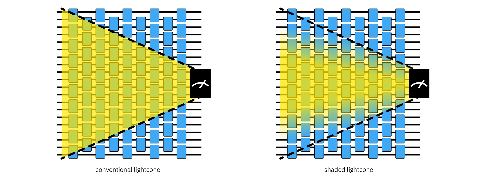
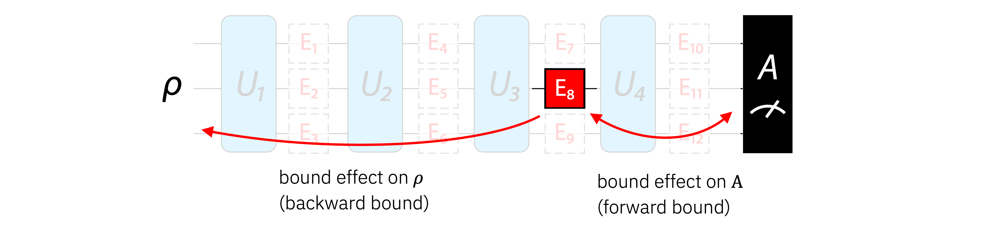
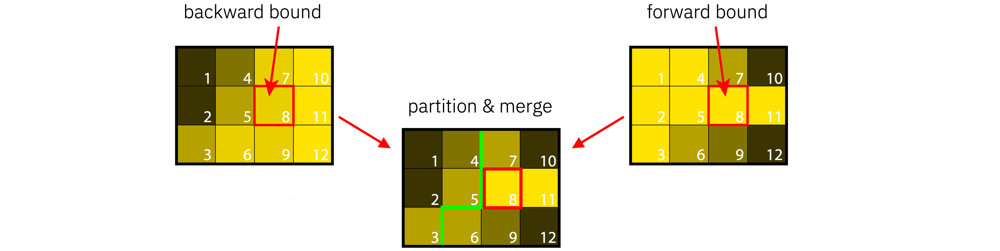
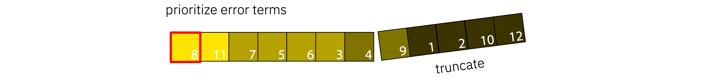
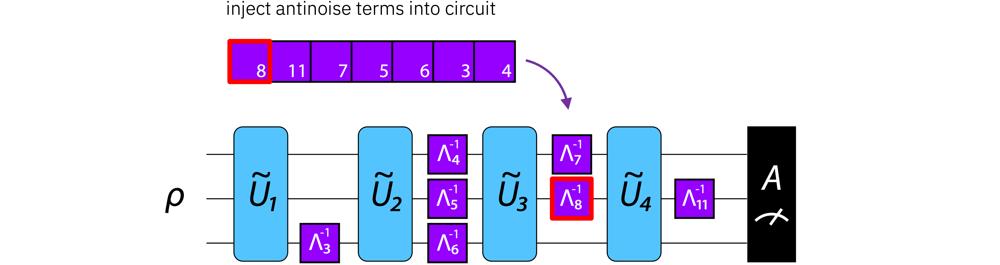

# Shaded lightcones (SLC)

`qiskit_mitigation.slc` is a sub-package for computing the shaded lightcone (SLC) [[1]](#references) of an
observable with respect to a quantum circuit. In the context of probabilistic error cancellation (PEC), shaded lightcones
are similar to conventional binary lightcones in that not mitigating errors outside the
lightcone can reduce the variance (i.e. sampling cost). Lightcone shading allows this strategy to
be pushed further by assigning scales to Pauli error generators within the causal lightcone.
Errors that are assigned smaller scales have less effect on the observable; truncating them from the
noise model can reduce variance (i.e. sampling cost) at the cost of some bias. The `qiskit_mitigation.slc` module
gives users the ability to do lightcone shading and control the tradeoff between sampling cost and bias.

----------------------------------------------------------------------------------------------------

### Use case examples

This technique has been used to lower the sampling cost of probabilistic error cancellation (PEC) for
operator Loschmidt echo experiments with 56 qubits on an IBM Heron processor. [[2]](#references).

----------------------------------------------------------------------------------------------------

### Technical discussion

#### Method overview

Shaded lightcones are calculated and used in 5 steps:

1. Compute a bound on the effect of each Pauli error term on the observable at the end of the circuit (forward bound)
2. Compute a bound on the effect of each Pauli error term on the initial state at the beginning of the circuit (backward bound)

3. Approximate a bias contribution for each Pauli error term using the forward/backward bounds and the term's error rate

4. Prioritize error terms based on their error rate and bounds. Truncate terms from the noise model which have the least effect on the observable expectation value until the user-specified bias tolerance is hit. Alternatively, one can add the most impactful error terms to a noise model until the user-specified sampling cost budget is filled.

5. Mitigate the truncated noise model. Using the [directed execution model](https://quantum.cloud.ibm.com/docs/guides/directed-execution-model) from Qiskit Runtime, specifying error terms to ignore during PEC sampling is straightforward. See the [tutorial](https://quantum.cloud.ibm.com/docs/tutorials/pec-with-shaded-lightcones) for details.

#### Software features

- Parallel asynchronous bound computation
- [Rust-accelerated Pauli propagation](https://github.com/Qiskit/pauli-prop)
- Rust-accelerated eigenvalue computation for computing forward bounds
- Permits ahead-of-time bound computation (i.e. prior to the actual noise learning)

#### Known issues

- `InjectNoise(site="before")` not supported
- Does not support fine-grained bound merging

----------------------------------------------------------------------------------------------------

### References

[1] Andrew Eddins, et al., [Lightcone shading for classically accelerated quantum error mitigation](https://arxiv.org/abs/2409.04401v1), arXiv:2409.04401v1 [quant-ph].

[2] Samantha V. Barron et al., [Observable Estimation in the Absence of Classical Verification](https://arxiv.org/pdf/2607.25998), arXiv:2607.25998 [quant-ph].
